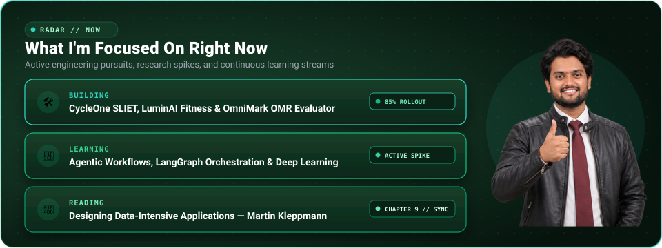
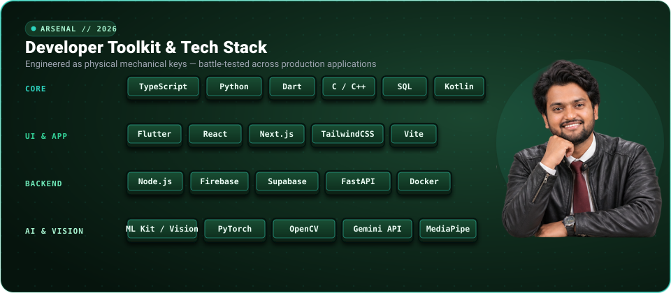
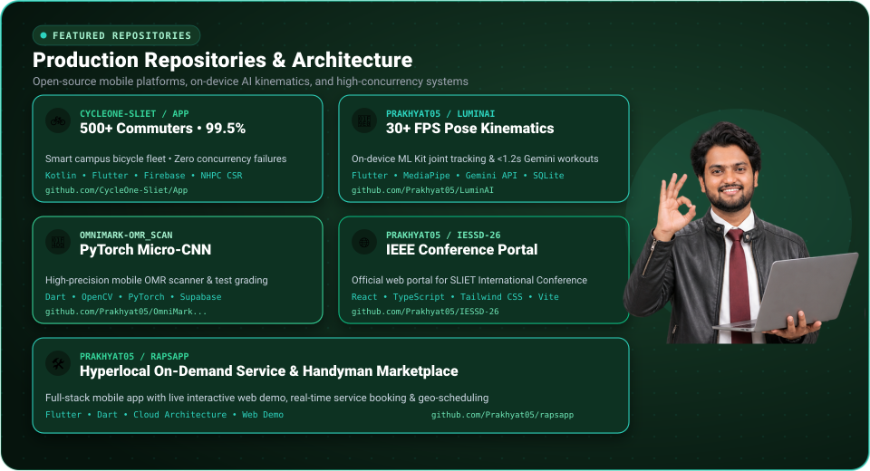

# 
✦ PRAKHYAT PRAKHAR ✦

  <b>Full Stack Developer • AI Integrations • Scalable Web &amp; Mobile Platforms</b>

  
  
  
  
  

> 🌐 **Interactive Portfolio**: Experience interactive 3D demos, live architectural deployments, and project showcases at **[prakhyatprakhar.netlify.app](https://prakhyatprakhar.netlify.app/)**  
> 📥 **Direct Resume Download**: Looking for my credentials? **[Download Prakhyat's Resume (PDF)](https://raw.githubusercontent.com/Prakhyat05/Prakhyat05/main/Prakhyat-Prakhar-Resume.pdf)** or view [`Prakhyat-Prakhar-Resume.pdf`](Prakhyat-Prakhar-Resume.pdf) in this repository.

---

## ⚡ 1. Introduction &amp; Core Identity

  

---

## 🚀 2. Currently Focused On (Building • Learning • Reading)

  

---

## ⌨️ 3. Developer Arsenal &amp; Mechanical Keyboard Stack

  

---

## 🐍 4. Live 365-Day GitHub Contribution Snake &amp; Commit Telemetry

  

---

## 💼 5. Production Repositories &amp; Engineering Deployments

  

### 🛠️ Key Featured Repositories

| Repository | Tech Stack &amp; Architecture | Engineering Highlights &amp; Metrics | Links |
| :--- | :--- | :--- | :--- |
| **[CycleOne-Sliet/App](https://github.com/CycleOne-Sliet/App)**  Smart Campus Bicycle Sharing | `Kotlin` • `Flutter` • `Firebase Cloud Functions` • `Serverless` | • Architected distributed campus mobility platform serving **500+ student commuters** across SLIET docking stations (**CSR funded by NHPC**). • Engineered automated station checkouts/check-ins with **zero concurrency failures** and **99.5%+ uptime**. | [🐙 GitHub Repository](https://github.com/CycleOne-Sliet/App) |
| **[Prakhyat05/LuminAI](https://github.com/Prakhyat05/LuminAI)**  Elite AI Personal Fitness Trainer | `Flutter` • `Google ML Kit` • `MediaPipe` • `Gemini API` • `SQLite` | • Real-time cross-platform pose detection and biomechanical multi-joint coordinate extraction at **30+ FPS** on-device. • Integrated **Gemini API** with structured prompt engineering and asynchronous thread isolation in Flutter, generating dynamic workouts in **under 1.2s** at **60 Hz** UI rendering. | [🐙 GitHub Repository](https://github.com/Prakhyat05/LuminAI) |
| **[Prakhyat05/OmniMark-OMR_Scan_Evaluator](https://github.com/Prakhyat05/OmniMark-OMR_Scan_Evaluator)**  High-Precision Mobile OMR Evaluator | `Dart` • `Flutter` • `OpenCV` • `PyTorch Micro-CNN` • `FastAPI` • `Supabase` | • Mobile Optical Mark Recognition (OMR) scanner with edge-computed computer vision and PyTorch Micro-CNN bubble classification. • Offline-first SQLite outbox synchronization pipeline with automated Supabase cloud exam grading reporting. | [🐙 GitHub Repository](https://github.com/Prakhyat05/OmniMark-OMR_Scan_Evaluator) |
| **[Prakhyat05/IESSD-26](https://github.com/Prakhyat05/IESSD-26)**  International Conference Web Portal | `React` • `TypeScript` • `Tailwind CSS` • `Vite` | • Official web portal for **IESSD'26** (*International Conference on Innovative Engineering Solutions for Sustainable Development* at SLIET Longowal). • High-speed responsive registration, speaker schedule, and paper submission portal. | [🐙 GitHub Repository](https://github.com/Prakhyat05/IESSD-26) |
| **[Prakhyat05/rapsapp](https://github.com/Prakhyat05/rapsapp)**  Hyperlocal On-Demand Service App | `Dart` • `Flutter` • `Firebase` • `Geolocation` • `Interactive Web Demo` | • Full-featured on-demand service and handyman marketplace application with real-time technician discovery and instant booking. • Includes live interactive web simulation and reactive state management. | [🐙 GitHub Repository](https://github.com/Prakhyat05/rapsapp) |

---

## 🃏 6. Collectible Player Card &amp; Engineering Lore

  

---

## 🤝 7. Collaboration &amp; Opportunities Terminal

  

---

## 👋 8. Say Hi &amp; Connect

  

### 📬 Quick Direct Connect Links
- 🌐 **Live Portfolio Website**: **[prakhyatprakhar.netlify.app](https://prakhyatprakhar.netlify.app/)** *(Interactive Demos, 3D Canvas &amp; Production Builds)*
- 📄 **Curriculum Vitae**: **[Download Resume PDF](https://raw.githubusercontent.com/Prakhyat05/Prakhyat05/main/Prakhyat-Prakhar-Resume.pdf)** (or view local [`Prakhyat-Prakhar-Resume.pdf`](Prakhyat-Prakhar-Resume.pdf))
- 💼 **LinkedIn Profile**: [linkedin.com/in/prakhyat-prakhar](https://www.linkedin.com/in/prakhyat-prakhar/)
- 🐙 **GitHub Profile**: [github.com/Prakhyat05](https://github.com/Prakhyat05)
- ✉️ **Direct Email**: [prakhyatprakhar2004@gmail.com](mailto:prakhyatprakhar2004@gmail.com)
- 📱 **Phone / WhatsApp**: [+91 9199008357](tel:+919199008357)
- 📍 **Location**: Bhagalpur, Bihar &amp; Longowal, Punjab, India *(Open to worldwide remote, hybrid, &amp; on-site roles)*

---

  <i>Crafted with precision • Animated with 100% pure CSS • Self-contained vector engineering</i>

